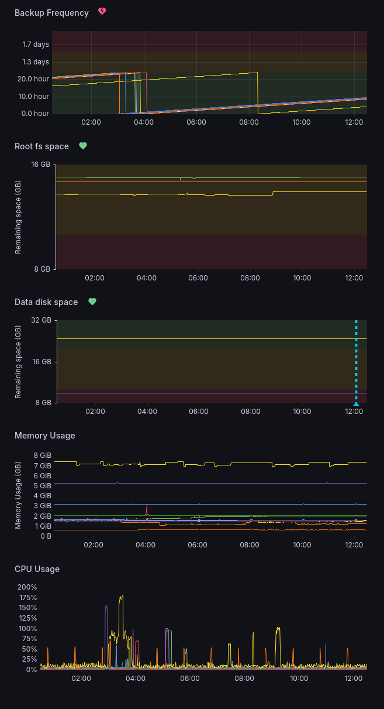

<!-- This file was edited with the assistance of an AI model and requires human review from the contributor. -->
<div align="center">

# *datalab* Grafana

</div>

Ansible playbook that deploys the monitoring stack for the federated [*datalab*](https://datalab-org.io) instances that are part of the [*datalab-org* federation](https://github.com/datalab-org/datalab-federation).

Stack components include:

- Prometheus,
- Prometheus blackbox exporter (uptime probes),
- Grafana (with provisioned dashboards, datasources and alert rules),
- nginx + Let's Encrypt,
- fail2ban.

all on a single Ubuntu 22.04/24.04 host running Docker.

<div align="center">

</div>

The monitoring itself (node-exporter, borgmatic-exporter, scrape config) is set up on the federated instances by [datalab-industries/datalab-ansible-terraform](https://github.com/datalab-industries/datalab-ansible-terraform); this repo only covers the central host that aggregates and visualises the metrics.

Built and maintained by [datalab industries](https://datalab.industries).

Shared in the spirit of "useful reference" rather than reuse — the inventory, secrets, and dashboards are tailored to our deployment. You're welcome to crib from it.

## What it observes

The default dashboard surfaces a per-instance view of:

- **Backup frequency** — time since the last successful borgmatic run.
- **Root and data filesystem usage** — free space on `/` and `/data`.
- **Memory and CPU usage** — basic node-exporter metrics.

Each datalab in `grafana_datalabs` (see [Uptime monitoring](#uptime-monitoring))
also gets its own dashboard, with every query pinned to that datalab: app/API
up/down status, uptime over the selected time range, response times, HTTP status
codes, TLS certificate expiry, time since last backup, and that deployment's
disk, memory and CPU usage. It is placed in the Grafana folder named by the
entry's optional `folder` key, or a folder named after the datalab if unset, so
it can be shared with that datalab's users (see
[Scoped collaborator dashboards](#scoped-collaborator-dashboards)).
These dashboards are rendered from
`ansible/roles/grafana/files/datalab-dashboard/dashboard.json`, where
`__DATALAB__` is replaced by the datalab name.

The provisioned alert rules (routed to PagerDuty) cover:

- **Backups** — fires if the last archive shrank by >1% relative to the previous day (corruption / truncation canary).
- **BackupsOverdue** — fires if no successful backup has been seen for >36 hours.
- **Root fs space** — fires when `/` drops below 10% free.
- **Data disk space** — fires when `/data` drops below 5 GB free.
- **Datalab down** — fires when an app or API uptime probe has not succeeded for 30 minutes.

## Uptime monitoring

The central host also probes each datalab's app and API over HTTPS every minute
using the [blackbox exporter](https://github.com/prometheus/blackbox_exporter)
(listening only on localhost), storing `probe_success`, `probe_duration_seconds`,
`probe_http_status_code` and `probe_ssl_earliest_cert_expiry` in Prometheus.
The app is probed at its web root and the API at `<api_url>/healthcheck/is_ready`.

The datalabs to monitor are set by `grafana_datalabs` in the vaulted inventory
(`make inventory` to edit it). This same list is used for both the uptime probes
and the Prometheus basic auth users that the instances remote-write with:

```yaml
grafana_prometheus_password: <plaintext, used by the Grafana datasource>
grafana_prometheus_password_hash: <bcrypt hash of the same password>
grafana_datalabs:
  - datalab: avnos  # must match the `datalab` label the instance remote-writes
    app_url: https://avnos-datalab.matgenix.com
    api_url: https://avnos-datalab-api.matgenix.com
    prometheus_user: avnos-datalab
    prometheus_password_hash: <bcrypt hash of that instance's prometheus_password>
    # folder: <name>  # optional Grafana folder for its dashboard; defaults to `datalab`
```

Prometheus only stores bcrypt hashes, so the plaintext passwords stay in each
instance's own inventory. A hash can be generated with, e.g.,
`htpasswd -nBC 12 "" | tr -d ':\n'`.
Each `prometheus_user` becomes a basic auth user in Prometheus's `web.yml`; the
playbook refuses to deploy if `grafana_prometheus_password_hash` is unset or an
entry has a `prometheus_user` without a `prometheus_password_hash`, as an empty
user list would leave Prometheus unauthenticated.

Either URL can be omitted to only probe the other (or both, for an instance that
only writes metrics); the role default is an empty list.

The `datalab` value must be the same `datalab` label the instance already sends
(`datalab_prefix`, or `app_url` if that is unset, in datalab-ansible-terraform),
so the probe results show up next to the rest of that deployment's metrics.
To check that every deployment sending metrics also has a probe, run this in
Prometheus; it lists any `datalab` that has no probe:

```promql
group by (datalab) (up{job="node-exporter"}) unless group by (datalab) (probe_success)
```

## Scoped collaborator dashboards

Each subdirectory under `ansible/roles/grafana/files/dashboards/` becomes its own
Grafana folder (the dashboard provider uses `foldersFromFilesStructure: true`).
To give an external collaborator a view onto only their own instances, drop a
dashboard into a dedicated folder with every PromQL target pinned to specific
`datalab` instance label values, e.g. `datalab=~"instance-a|instance-b"`. This
keeps the panels scoped to a selected subset rather than the whole federation.
The generated per-datalab dashboards already follow this pattern: set an entry's
`folder` to put its dashboard alongside any hand-written ones for the same
collaborator (both providers' dashboards share a Grafana folder of the same name).

Provisioned folders are matched to existing Grafana folders **by title**. To
rename a folder without losing its permissions (e.g., `matgenix` → `avnos`),
rename it in the Grafana UI *before* deploying the renamed directory or `folder`
value; otherwise a new folder is created without the old folder's permissions,
and the old one is left behind empty.

The dashboard JSON alone does **not** enforce the access boundary — it only
controls what the panels query. In OSS Grafana there are no per-datasource
permissions (that is an Enterprise feature), so the boundary is enforced by the
user's role plus folder permissions:

1. **Org role = Viewer** for the collaborator's account. Viewers cannot open
   Explore or edit panel queries by default, so they cannot run arbitrary
   PromQL against the shared Prometheus datasource — they only ever see the
   pinned queries in dashboards they can access.
2. **Folder permission**: grant that user (or a team) the *View* role on their
   folder, and make sure they do not also hold a broad org-wide Viewer grant
   that would expose the other folders.

Both steps are done in the Grafana UI (or via a separate user/permissions
config); they are not part of this repo's file-based provisioning.

## Deploying

The [`Makefile`](Makefile) wraps `ansible-playbook` with the inventory and vault
password:

- `make install-ansible` sets up a virtualenv with Ansible and the required collections,
- `make` runs the whole playbook, and `make <tag>` (e.g., `make deploy`) runs only that tag (`make list` shows them all),
- `make inventory` edits the vaulted inventory, `make vaults` picks any vault file to edit, and `make encrypt-vaults` encrypts all of them.

If [rbw](https://github.com/doy/rbw) is installed, the vault password is read
from Bitwarden by [`.vault-pass.sh`](.vault-pass.sh), which looks for an entry
named after the git remote (`datalab-industries/datalab-grafana-deployment`, then
`datalab-grafana-deployment`, then the legacy `grafana ansible`), and asks for the
password if none is found. Without rbw, `make` asks for the vault password.
